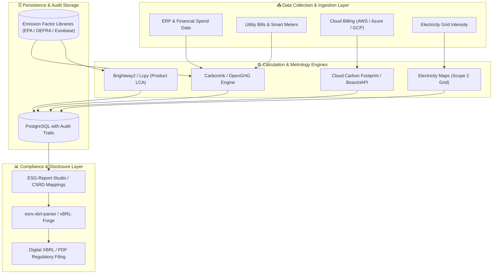

# 🌍 Awesome ESG & Carbon Accounting Software

  <strong>A curated ecosystem of enterprise SaaS platforms, open-source repositories, and calculation engines for Scope 1–3 emissions, CSRD / ESRS compliance, LCA, and decarbonization.</strong>

  
  
  
  
  
  

---

## 📌 Table of Contents

- [🌿 Executive Overview](#-executive-overview)
- [📈 Sector Overview & Market Dynamics](#-sector-overview--market-dynamics)
- [🏢 Enterprise SaaS & Hosted Platforms](#-enterprise-saas--hosted-platforms)
  - [SaaS Comparison Matrix](#-saas-comparison-matrix)
  - [Platform Deep Dives](#-platform-deep-dives)
- [💻 Open-Source GitHub Projects](#-open-source-github-projects)
  - [Ranked Open-Source Repositories](#-ranked-open-source-repositories)
  - [Open Standards, Metrology & Emerging Tools](#-open-standards-metrology--emerging-tools)
- [🏗️ Recommended Open Architecture Stack](#️-recommended-open-architecture-stack)
- [🌟 Star History](#-star-history)
- [💖 Support & Community](#-support--community)
- [🤝 How to Contribute](#-how-to-contribute)
- [⚖️ Disclaimer & Standards Compliance](#️-disclaimer--standards-compliance)

---

## 🌿 Executive Overview

Corporate sustainability data management has transitioned from voluntary public relations disclosures to strict, auditable statutory accounting. Driven by legal frameworks such as the **European Union Corporate Sustainability Reporting Directive (CSRD / ESRS)**, the **US SEC Climate Disclosure Regulations**, **California SB 253/SB 261**, and **IFRS / ISSB Standards**, organizations require auditable systems for:

* **Scope 1 (Direct Emissions):** Fuel combustion, company vehicles, and fugitive industrial refrigerants.
* **Scope 2 (Indirect Emissions):** Purchased electricity, heat, steam, and cooling (location-based and market-based accounting).
* **Scope 3 (Value Chain Emissions):** 15 upstream and downstream categories including purchased goods, business travel, capital goods, logistics, and financed emissions under PCAF.
* **Product Carbon Footprints (PCF) & Life Cycle Assessment (LCA):** Cradle-to-gate and cradle-to-grave emissions per product unit.
* **Digital Tagging & XBRL:** Electronic tagging of CSRD / ESRS sustainability statements for regulatory audit readiness.

---

## 📈 Sector Overview & Market Dynamics

The global **Carbon Accounting and ESG Software market** is estimated at approximately **$17.8 Billion to $27.5 Billion in 2026** (growing at an ~18% to 23% CAGR toward **$50+ Billion by 2030**), propelled by mandatory statutory compliance and audit enforcement worldwide.

### Market Structure & Competitive Landscape

* **Moderately Concentrated Core (Incumbents ~40% Enterprise Share):** Legacy ERP and cloud giants—notably **Salesforce (Net Zero Cloud)**, **Microsoft (Cloud for Sustainability)**, **SAP (Sustainability Control Tower)**, and **IBM (Envizi)**—hold substantial enterprise share by bundling emissions accounting into existing financial ledgers, CRM databases, and enterprise resource planning software.
* **Highly Fragmented Innovator Tier (Pure-Play Specialized Vendors):** The broader market remains heavily fragmented across hundreds of specialized climate-tech startups (e.g., **Watershed**, **Persefoni**, **Sweep**, **Greenly**, **Plan A**). These pure-plays capture market share by innovating faster on complex Scope 3 supplier engagement, automated activity-data ingestion, granular emission-factor libraries (Exiobase, Ecoinvent, DEFRA, EPA), and CSRD double materiality analysis.
* **Consolidation Trend:** As compliance scrutiny increases, the sector is experiencing steady M&A consolidation—exemplified by Blackstone's multi-billion acquisition of Sphera, Greenly's merger with Normative, and Green Project Technologies' acquisition of Emitwise.

---

## 🏢 Enterprise SaaS & Hosted Platforms

### 📊 SaaS Comparison Matrix

> All platforms are ranked in **descending order by company size** (market capitalization, valuation, or estimated annual revenue).

| 🏢 Platform | 💰 Valuation / Company Size | 🏷️ Starting Tier Pricing | 🆓 Free Tier / Trial Limits | 🎯 Primary Focus & Emissions Scope |
| :--- | :--- | :--- | :--- | :--- |
| **[Salesforce Net Zero Cloud](https://www.salesforce.com/products/net-zero-cloud/)** | **~$270 Billion** Market Cap / $34.9B Revenue *(Salesforce, Inc.)* | **$48,000 / org / year** *(Starter edition; $4,000/mo billed annually with 3 CRM licenses; Growth tier at $210,000/yr)* | **30-day free trial** *(Full sandbox environment; choose pre-loaded Learning Org with Scope 1–3 sample data or blank Base Org; no credit card required; 0-day permanent free tier)* | Enterprise CRM-integrated carbon ledger, supplier engagement portals, and CSRD audit-trail tracking. |
| **[Sphera (SpheraCloud)](https://sphera.com/)** | **~$1.4B – $3.0B** Valuation *(Blackstone portfolio; ~$150M–$300M ARR)* | **$16,800 – $40,000 / year** *(Base corporate sustainability module; multi-facility enterprise suites exceed $100,000/yr)* | **45-day evaluation trial** *(Available for specialized technical modules like Sphera LCA for Experts; limited to 1 user and single-study dataset; core SpheraCloud via guided demo only; 0-day permanent free tier)* | Corporate carbon footprinting, Product Carbon Footprints (PCF), Life Cycle Assessment (LCA), and supply chain compliance. |
| **[Watershed](https://watershed.com/)** | **$1.8 Billion** Valuation *(Series C backed by Greenoaks; ~$50M+ ARR)* | **$37,000 – $50,000 / year** *(Base single-entity mid-market tier; multi-entity enterprise configurations range from $70,000 to $250,000+/year)* | **14-day guided proof-of-concept (POC) sandbox** *(Available upon sales qualification; restricted to 1 corporate legal entity, 1 user login, and Scope 1/2 demo data ingestion; 0-day permanent free tier)* | Enterprise climate management, Scope 1–3 measurement, clean energy procurement, and CSRD / SEC climate disclosure. |
| **[Persefoni](https://persefoni.com/)** | **~$1.0 Billion** Valuation *(Series B led by The Rise Fund / Rice; $150M+ venture funding)* | **$0 / year** *(Persefoni Pro free-forever tier)*; **$55,000 / year** *(Persefoni Advanced & Enterprise tiers)* | **Free-forever plan ("Persefoni Pro")** *(Unlimited time duration; 1 user login; covers Scope 1, Scope 2, and all 15 Scope 3 categories; unlimited facilities/assets; includes AI Copilot and CSRD/CDP framework exports)* | Climate Management & Accounting Platform (CMAP), PCAF-aligned financed emissions for banking/PE, and CSRD compliance. |
| **[Sweep](https://www.sweep.net/)** | **~$300 Million** Valuation *($100M total funding; Series B backed by Coatue & Balderton)* | **€3,000 / year** *(~$250/mo billed annually for entry-level starter tier; enterprise tree deployments scale from €12,000+/yr)* | **14-day guided pilot sandbox** *(Offered upon demo qualification; limited to 1 corporate hierarchy tree, up to 3 users, and 50 data points/emission survey responses; 0-day permanent free tier)* | Collaborative carbon and ESG data management, corporate tree hierarchies, supplier surveys, and CSRD / ISSB reporting. |
| **[Greenly](https://greenly.earth/)** | **~$200 Million** Valuation *($75M total funding; Series B led by Fidelity International)* | **$1,950 – $3,800 / year** *(SMB Starter begins at $1,950/yr; GHG Report Compliance starts at $3,800/yr; CSRD Transition starts at $8,000/yr)* | **Free-forever online carbon calculator & assessment** *(Unlimited duration; 1 user login; instant spend-based Scope 1–3 estimate); full platform features accessible via 7-day guided sandbox demo* | Automated Scope 1–3 carbon accounting for SMBs and mid-market, automated accounting/bank integrations, and CSRD readiness. |
| **[Plan A](https://plana.earth/)** | **~$150 Million** Valuation *($40M+ funding; acquired by Diginex; ~$10M+ ARR)* | **€4,500 / year** *(~$4,900/yr for Essential tier for organizations <50 employees; Pro tier starts from €15,000+/yr)* | **14-day guided evaluation sandbox** *(Scheduled with climate specialist; restricted to 1 corporate facility and Scope 1 & 2 baseline testing dataset; 0-day permanent free tier)* | Certified TÜV Rheinland carbon accounting engine, CSRD/ESRS disclosure modules, and science-based decarbonization targets. |
| **[Normative](https://normative.io/)** | **~$120M – $150M** Valuation *($36M funding from ETF Partners & 2150; merged with Greenly)* | **€6,000 / year** *(~$6,500/yr for Essential tier covering Scopes 1–3; Premium value-chain tier starts at €25,000+/yr)* | **Free-forever Business Carbon Calculator** *(Via UN SME Climate Hub; free forever for businesses <500 employees; calculates Scope 1, 2, and basic Scope 3; 1 user); enterprise platform provides 0-day self-serve trial (guided 30-min demo only)* | Science-based enterprise emissions engine, automated ERP/ledger transaction matching, and CSRD compliance. |
| **[Sinai Technologies](https://www.sinai.com/)** | **~$50M – $100M** Valuation *($39.2M venture funding through Series B)* | **$12,000 / year** *(Entry decarbonization and Marginal Abatement Cost Curve module; enterprise multi-facility suites scale to $60,000+/yr)* | **14-day pilot evaluation sandbox** *(Provided post-demo; limited to 1 industrial facility dataset and sample marginal abatement curve simulation; 0-day permanent free tier)* | Decarbonization platform for carbon-intensive industries (manufacturing, transport), scenario analysis, and internal carbon pricing. |
| **[Emitwise (Green Project Technologies)](https://emitwise.com/)** | **~$30M – $50M** Valuation *(Acquired by Green Project Technologies in 2025; raised $6.6M seed)* | **$10,000 / year** *(Entry-level supply chain carbon footprinting & PCF module under Green Project Tech)* | **14-day evaluation sandbox** *(Available for procurement teams upon sales qualification; restricted to 1 supplier campaign and sample product footprint; 0-day permanent free tier)* | AI-driven Scope 3 value-chain mapping, Product Carbon Footprints (PCF), and automated supplier emissions engagement. |

---

### 🔍 Platform Deep Dives

* **[Salesforce Net Zero Cloud](https://www.salesforce.com/products/net-zero-cloud/)**  
  Built directly on the Salesforce CRM architecture. Enables organizations to ingest energy consumption data, travel records, and procurement spend to produce automated Scope 1, 2, and 3 GHG accounting snapshots. Includes pre-configured CSRD reporting templates and supplier collaboration portals.

* **[Sphera (SpheraCloud)](https://sphera.com/)**  
  Enterprise Environmental, Health, Safety & Sustainability (EHS&S) platform backed by Blackstone. Combines corporate GHG accounting with life cycle assessment (LCA) tools (*LCA for Experts / GaBi*), chemical management, and product compliance for industrial manufacturers.

* **[Watershed](https://watershed.com/)**  
  Climate platform built for global enterprises. Features granular supplier data ingestion, automated ERP data classification, emissions reduction pathways, clean power procurement tools, and audit-ready outputs for CSRD, SEC, and CDP filings.

* **[Persefoni](https://persefoni.com/)**  
  Climate Management and Accounting Platform (CMAP) specializing in financial institutions and multinational corporations. Implements Partnership for Carbon Accounting Financials (PCAF) standards for financed emissions (Scope 3 Category 15) and offers the self-service **Persefoni Pro** free tier.

* **[Sweep](https://www.sweep.net/)**  
  Collaborative carbon and ESG data management platform. Uses tree-structured business hierarchies to map complex subsidiaries and value chains, facilitating localized data collection and aggregated CSRD/ISSB disclosure.

* **[Greenly](https://greenly.earth/)**  
  Designed for small-to-midsize businesses and high-growth companies. Automates emissions calculations by integrating directly with over 100 enterprise accounting systems, banks, and cloud providers. Offers entry-level SME pricing and quick onboarding.

* **[Plan A](https://plana.earth/)**  
  Berlin-based carbon accounting and ESG platform certified by TÜV Rheinland. Delivers automated data pipelines, double materiality workflows, and ESRS-aligned CSRD disclosure generation with actionable emissions reduction roadmaps.

* **[Normative](https://normative.io/)**  
  Science-based carbon accounting engine developed in collaboration with climate scientists. Powers the UN SME Climate Hub's free calculator and provides mid-market and enterprise teams with automated Scope 1–3 calculations and supply chain emissions mapping.

* **[Sinai Technologies](https://www.sinai.com/)**  
  Decarbonization intelligence platform built for complex, carbon-heavy industrial supply chains. Distinguishes itself with advanced Marginal Abatement Cost Curve (MACC) modeling, dynamic carbon pricing, and mitigation scenario simulations.

* **[Emitwise (Green Project Technologies)](https://emitwise.com/)**  
  AI-augmented carbon accounting platform with a focus on manufacturing and complex supply chains. Delivers primary supplier engagement campaigns, Product Carbon Footprints (PCF), and Scope 3 supplier data verification.

---

## 💻 Open-Source GitHub Projects

Open-source carbon accounting software enables self-hosting, transparent calculation math, vendor independence, and verifiable audit trails. 

### 🌟 Ranked Open-Source Repositories

> All repositories are strictly ranked in **descending order by GitHub star count**. Star badges link directly to each repository's stargazers community.

* **[Electricity Maps](https://github.com/electricitymaps/electricitymaps-contrib)**   
  *The open-source repository for Electricity Maps data parsers and carbon intensity calculations.*  
  Real-time, 24/7 hourly grid carbon intensity data across global regions. Powers granular Scope 2 market-based carbon accounting and carbon-aware load shifting for digital infrastructure.  
  *Stack: Python • TypeScript*

* **[Cloud Carbon Footprint](https://github.com/cloud-carbon-footprint/cloud-carbon-footprint)**   
  *Estimate energy use (kWh) and carbon emissions (metric tons CO2e) from public cloud usage.*  
  Connects to AWS, Microsoft Azure, and Google Cloud billing and usage APIs to calculate compute, storage, and networking emissions for Scope 3 digital footprint auditing.  
  *Stack: TypeScript • React • Node.js*

* **[Carbon-Aware SDK](https://github.com/Green-Software-Foundation/carbon-aware-sdk)**   
  *Green Software Foundation SDK for building carbon-aware software systems.*  
  Provides Web APIs and client libraries that fetch local electricity grid marginal emissions data to help software schedule compute tasks at times when renewable energy is abundant.  
  *Stack: C# • Python • TypeScript*

* **[CO2.js](https://github.com/thegreenwebfoundation/co2.js)**   
  *An npm module for estimating carbon emissions from digital systems and web applications.*  
  Developed by The Green Web Foundation. Implements the OneByte model and the Sustainable Web Design (SWD) methodology to calculate emissions from digital data transfer and website operations.  
  *Stack: JavaScript (Node.js & Browser)*

* **[CarbonTracker](https://github.com/saintslab/carbontracker)**   
  *Track, predict, and log energy consumption and GHG emissions of training machine learning models.*  
  Monitors GPU, CPU, and DRAM power consumption in real time during deep learning training epochs and converts energy consumption into CO2 equivalent using regional grid emissions factors.  
  *Stack: Python • PyTorch • TensorFlow*

* **[Greenframe CLI](https://github.com/marmelab/greenframe-cli)**   
  *Measure the carbon footprint of user scenarios on web applications.*  
  Simulates real user journeys using headless browsers, tracks resource utilization (CPU, network, memory), and outputs standardized emissions scores for green software engineering.  
  *Stack: TypeScript • Docker*

* **[Blockchain Carbon Accounting](https://github.com/hyperledger-labs/blockchain-carbon-accounting)**   
  *Decentralized climate action and accounting ledger by Hyperledger Climate Action & Accounting SIG.*  
  Implements blockchain smart contracts for auditable greenhouse gas emissions calculations, renewable energy certificates (RECs), and decentralized verification of climate claims. (Collaboratively maintained with [Open-Earth-Foundation](https://github.com/Open-Earth-Foundation/blockchain-carbon-accounting)).  
  *Stack: TypeScript • Solidity • Python*

* **[Activity Browser](https://github.com/LCA-ActivityBrowser/activity-browser)**   
  *Open-source Graphical User Interface for Brightway2 Life Cycle Assessment.*  
  Features multi-scenario modeling, Monte Carlo uncertainty analysis, Sankey diagrams, contribution analyses, and global sensitivity evaluations for product and corporate LCA.  
  *Stack: Python • PyQt • Brightway2*

* **[Brightway2](https://github.com/brightway-lca/brightway2)**   
  *Advanced open-source Python framework for Life Cycle Assessment (LCA) calculations.*  
  Matrix-based LCA computational engine supporting multiple life cycle databases (Ecoinvent), dynamic inventory calculation, and parametric modeling.  
  *Stack: Python • NumPy • SciPy*

* **[BoaviztAPI](https://github.com/Boavizta/boaviztapi)**   
  *Open reference data and methodology API for evaluating environmental impacts of IT equipment.*  
  Calculates manufacturing (embedded) and operational carbon footprint (GHG), abiotic resource depletion (ADP), and primary energy use for cloud instances, physical servers, and user terminals.  
  *Stack: Python • FastAPI*

* **[Lcpy](https://github.com/spirdgk/lcpy)**   
  *Parametric and dynamic Life Cycle Assessment (LCA) and Life Cycle Costing (LCC) package.*  
  Integrates LCA computational models with chemical process simulations, optimization routines, and machine learning for industrial decarbonization engineering.  
  *Stack: Python*

* **[esrs-xbrl-parser](https://github.com/aimabel-ai/esrs-xbrl-parser)**   
  *Parser and validation engine for European Sustainability Reporting Standards (ESRS) XBRL taxonomies.*  
  Parses EFRAG-approved ESRS XBRL taxonomy definitions to validate digital CSRD filings and structured sustainability data.  
  *Stack: TypeScript*

* **[xBRL-Forge](https://github.com/antonheitz/xBRL-Forge)**   
  *Open-source iXBRL report and XBRL taxonomy generator.*  
  Builds digital financial and ESG disclosure documents with full XBRL compliance for regulatory audit trails.  
  *Stack: Python*

* **[CarbonInk](https://github.com/lxzxl/carbonink)**   
  *Local-first, privacy-preserving desktop application for corporate GHG accounting (MIT).*  
  Features offline AI bill/receipt extraction, ISO 14064-1 compliance, audit-grade calculation snapshots, and a built-in MCP server for Claude and Cursor integration.  
  *Stack: Rust • TypeScript • React*

* **[ESG Reporting AI](https://github.com/shashank-dj/esg-reporting-ai)**   
  *AI-augmented ESG reporting platform combining deterministic calculations with CSRD/ESRS copilots.*  
  Features Scope 1/2 calculation, Scope 3 spend estimation, CSRD/ESRS E1 disclosure mapping, GRI coverage heatmaps, and audit readiness scoring.  
  *Stack: Python • Streamlit*

* **[ESG-Copilot](https://github.com/omkardongre/ESG-Copilot)**   
  *Enterprise AI-powered ESG compliance automation framework.*  
  Orchestrates specialized agents: Regulation Research, ESG Data Ingestion, Emissions Calculator (via Climatiq API), and Multi-Framework Report Synthesizer (GRI/SASB/TCFD).  
  *Stack: Next.js 14 • Node.js • LangChain.js • Gemini*

* **[carbon-footprint-mcp](https://github.com/MayankTalwar0/carbon-footprint-mcp)**   
  *MCP server for calculating organizational carbon footprints from bank transactions and spend exports.*  
  Runs 100% locally with zero external financial API data leakage. Computes Scope 1, 2, and 3 emissions using EPA GHG emission factors. Also published on [PyPI](https://pypi.org/project/carbon-footprint-mcp/).  
  *Stack: Python • Model Context Protocol (MCP)*

* **[ESG-Report-Studio](https://github.com/SebastianDabkowski/ESG-Report-Studio)**   
  *Structured ESG responsibility report platform supporting controlled, auditable sustainability compliance.*  
  Treats sustainability reports as auditable compliance artifacts rather than marketing documents, with CSRD/ESRS requirement mappings and audit retention policies.  
  *Stack: TypeScript*

* **[OpenGHG Carbon Calculator](https://github.com/mindsongreen/OpenGHG)**   
  *Transparent, auditable carbon footprint calculator engine with explicit unit algebra.*  
  Features complete separation of activity data, emission factors, and calculation domains, allowing organizations to self-host sensitive operational metrics.  
  *Stack: PHP • PostgreSQL • JavaScript*

---

### 🔬 Open Standards, Metrology & Emerging Tools

* **[SCOOP Carbon Accounting Project](https://github.com/SCOOP-Carbon-Accounting)**  
  Open-source carbon accounting project applying metrology discipline and financial reporting rigor to carbon emissions. Translates IEEE standards efforts **P7802** and **P3469** into practical calculations. Presented at IEEE SusTech 2026.
* **[Appa LCA](https://github.com/appalca)**  
  Python framework for integrating Life Cycle Assessment directly into industrial ecodesign product workflows.
* **[pyteea-lca](https://gitlab.dlr.de/tt-tea/teeatool/pyteea-lca)**  
  Object-oriented Python Life Cycle Assessment framework developed at the German Aerospace Center (DLR).
* **[WILMA](https://dinaopt.w-hs.de)**  
  AI-supported assistance system for CSRD double materiality analysis developed by Westfälische Hochschule for small and medium-sized enterprises.

---

## 🏗️ Recommended Open Architecture Stack

For engineering teams and sustainability architects seeking a self-hosted, vendor-independent carbon management platform:

---

## 🌟 Star History

---

## 💖 Support & Community

Thank you for visiting and supporting the **Awesome ESG & Carbon Accounting Software** ecosystem! 🌱 Building and curating open, auditable resources for climate-tech developers, corporate sustainability managers, and compliance auditors is an ongoing community initiative.

If you find this directory valuable:
* ⭐ **Star this repository** on GitHub to increase visibility and help other teams discover these tools.
* 🍴 **Fork and share** with colleagues in your sustainability, ESG, and engineering networks.
* 📢 **Spread the word** on LinkedIn, Discord, and climate-tech communities.
* ☕ **Sponsor & Buy Me a Coffee:** Support continuous updates, research, and open-source climate tooling directly via the [GitHub Sponsor Dashboard](https://github.com/sponsors/ishandutta2007).

  

---

## 🤝 How to Contribute

Contributions from sustainability practitioners, ESG analysts, and software developers are warmly welcomed!

1. **Fork the repository** to your GitHub account.
2. **Add or update an entry** in [README.md](README.md):
   * For SaaS tools: include verified pricing tier, free trial/tier limits, valuation, and key capabilities.
   * For Open-Source tools: include repository link, stargazers social badge (`style=social&color=white`), and factual description.
3. **Keep descriptions objective and factual** without promotional fluff.
4. **Submit a Pull Request** with a clear explanation of changes.

---

## ⚖️ Disclaimer & Standards Compliance

* This repository is a community-curated directory intended for research, educational, and benchmarking purposes. It does not constitute formal legal, financial, or environmental audit advice.
* Corporate ESG reporting and greenhouse gas accounting statements must adhere to applicable regional regulations (**CSRD**, **ESRS**, **SEC Climate Rules**, **GHG Protocol Corporate Standard**, **ISO 14064**, **PCAF**).
* Organizations utilizing self-hosted open-source software are responsible for validating emission factors, calculation methodologies, and data lineage with their appointed third-party assurance providers and statutory auditors.

---

  Curated with 💚 for sustainability officers, ESG teams, and climate-tech engineers building auditable, transparent carbon accounting.

